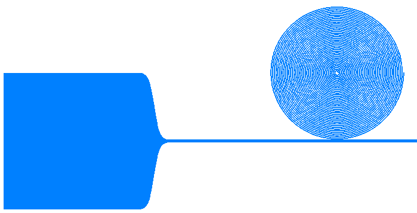
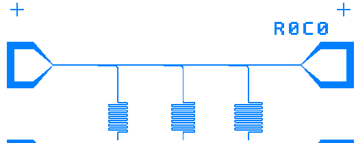

# PyGDSdesign

**Make Amazing GDS Files with Few Lines of Python**

[](https://badge.fury.io/py/pygdsdesign)
[](https://pypi.org/project/pygdsdesign/)
[](https://github.com/edumur/pygdsdesign/blob/main/LICENSE.txt)
[](https://pepy.tech/project/pygdsdesign)

---

## 📖 Overview

PyGDSdesign is a powerful Python library for generating GDS (Graphic Database System) files through intuitive Python scripts. Built on the foundation of GDSpy, a widely-used open-source toolkit for layout design, PyGDSdesign leverages the Clipper library to execute precise boolean operations, making it an essential tool for researchers and engineers working in microelectronics, quantum computing, and nanofabrication.

---

## ✨ Key Features

- **Simple Python API**: Create complex GDS layouts with minimal code
- **Built on GDSpy**: Inherits robust layout design and manipulation capabilities
- **Precise Boolean Operations**: Powered by Clipper library for accurate geometric operations
- **Specialized for Microwave Circuits**: Optimized for designing spiral resonators, CPW resonators, and other RF components
- **Active Development**: Regular updates and improvements

---

## 📦 Installation

### 🐍 From PyPI (Recommended)

First, ensure you have the required dependencies:

```bash
conda install numpy scipy tqdm
```

Then install PyGDSdesign:

```bash
pip install pygdsdesign
```

### ⚒️ From Source

Since PyGDSdesign incorporates C++ code that requires compilation (Clipper library), you'll need a C++ compiler installed on your system before installation.
- Download from: [https://visualstudio.microsoft.com/downloads/](https://visualstudio.microsoft.com/downloads/)
- Downloads the community version
- Download "Build Tools for Visual Studio 2022" (or latest version)
- Run the installer
- Select "Desktop development with C++" workload
- Click Install (requires ~7GB disk space)

#### Installation Steps

Once you have a C++ compiler installed:

1. **Clone the repository:**
   ```bash
   git clone https://github.com/edumur/pygdsdesign.git
   cd pygdsdesign
   ```

2. **Install in standard mode:**
   ```bash
   pip install .
   ```

3. **Or install in development/editable mode** (for contributors):
   ```bash
   pip install -e .
   ```

---

## 🚀 Quick Start

PyGDSdesign makes it easy to create complex layouts with just a few lines of code. Here's a simple example:

```python
import pygdsdesign as gds

# Create a new library
lib = gds.GdsLibrary()

# Create a cell
cell = lib.new_cell('MY_DESIGN')

# Add shapes
rect = gds.Rectangle((0, 0), (10, 5))
cell.add(rect)

# Save to file
lib.write_gds('output.gds')
```

---

## 🎨 Gallery

### Spiral Resonator



A beautifully designed spiral resonator showcasing the library's ability to create intricate curved structures with precise control.

### CPW Resonators



Coplanar waveguide (CPW) resonators demonstrating the library's capability for designing transmission line structures commonly used in quantum computing and microwave applications.

---

## 💡 Examples

The repository includes numerous example scripts in the `examples/` folder demonstrating various use cases.

To explore the examples:

```bash
cd examples/
python spiral_resonator.py
```

---

## ⚙️ Technical Details

### Language Distribution

- **Python**: 76.2% (Main API and high-level functionality)
- **C++**: 23.6% (Clipper library for boolean operations)
- **CMake**: 0.2% (Build configuration)

### Dependencies

- **numpy**: Numerical computing and array operations
- **scipy**: Scientific computing functions
- **tqdm**: Progress bars for long operations

### Compatibility

- **Python**: 3.11+
- **Operating Systems**: Windows
- **License**: Boost Software License 1.0 (BSL-1.0)

---

## 🤝 Contributing

Contributions are welcome! Whether it's bug reports, feature requests, or code contributions, we appreciate community involvement.

### How to Contribute

1. Fork the repository
2. Create a feature branch (`git checkout -b feature/amazing-feature`)
3. Make your changes
4. Commit your changes (`git commit -m 'Add amazing feature'`)
5. Push to the branch (`git push origin feature/amazing-feature`)
6. Open a Pull Request

---

## 📝 Changelog

For a detailed list of changes, improvements, and bug fixes in each version, please refer to [CHANGELOG.md](CHANGELOG.md).

---

## 📄 License

PyGDSdesign is released under the **Boost Software License 1.0** (BSL-1.0). This is a permissive open-source license that allows for both commercial and non-commercial use.

See [LICENSE.txt](LICENSE.txt) for the full license text.

---

## 👥 Authors and Acknowledgments

### Authors

- **Étienne Dumur** - Original author and primary maintainer
- **Sacha Wos** - Python 3.8 to 3.11+ compatibility

### Acknowledgments

This library incorporates significant code and inspiration from:

- **GDSPY** by Lucas H. Gabrielli - Core layout functionality and GDS file handling
- **Clipper** by Angus Johnson - Robust boolean operations on polygons

We are grateful to the open-source community for these foundational tools that make PyGDSdesign possible.

---

## 📖 Citation

If you use PyGDSdesign in your research, please consider citing it:

```
Dumur, É., & Wos, S. (2024). PyGDSdesign: A Python library for GDS layout design.
GitHub repository: https://github.com/edumur/pygdsdesign
```

---

## 🔗 Related Projects

- **[GDSpy](https://github.com/heitzmann/gdspy)**: The underlying library for GDS operations
- **[KLayout](https://github.com/KLayout/klayout)**: Popular GDS viewer and editor
- **[gdstk](https://github.com/heitzmann/gdstk)**: Another Python library for GDS manipulation
- **[Qiskit Metal](https://github.com/Qiskit/qiskit-metal)**: Framework for quantum device design

---

## 📧 Contact

For questions, suggestions, or collaboration opportunities:

- **GitHub**: [https://github.com/edumur/pygdsdesign](https://github.com/edumur/pygdsdesign)
- **Issues**: [https://github.com/edumur/pygdsdesign/issues](https://github.com/edumur/pygdsdesign/issues)
